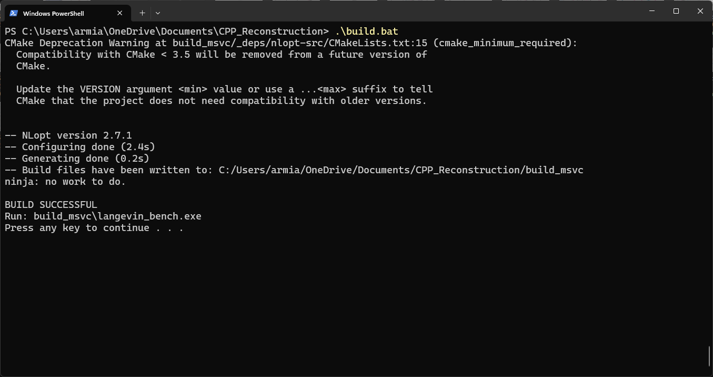
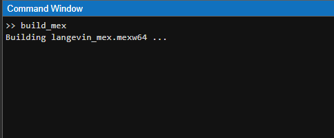

# C++ Port of [MATLAB-reconstruction-package](https://github.com/mshoja/MATLAB-reconstruction-package)

The original package fits Langevin models, `dx = mu(x) dt + sigma(x) dW`, to time series by maximum likelihood. This port evaluates the negative log-likelihood in C++ (`langevin_core.cpp`), built into a MEX file (`langevin_mex`). The MATLAB code uses it when it is compiled, which is about 10 times faster, and falls back to MATLAB when it is not.

## Requirements to Build the Project 
- [Visual Studio 2026](https://visualstudio.microsoft.com/)
- [CMake](https://cmake.org/)
- [vcpkg](https://vcpkg.io/en/)

## Dependencies Used in This Project
- **Eigen3**
- **NLopt**

To build the project, first compile it by running `build.bat` in the terminal. Then, in MATLAB, execute `build_mex` inside the Command Window.

**Note:** You do not need to install Visual Studio or CMake just to run the example. You can run it directly in MATLAB as you normally would.
